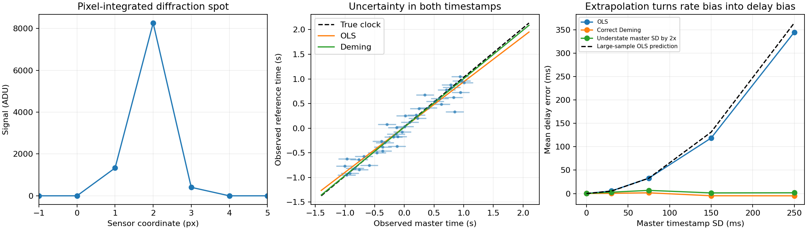

# Noisy clocks, sharp images: optical camera timing

A 45–60 minute integrated learning lab. Can a precisely localized diffraction spot still give the wrong camera delay? Yes: treating a noisy calibration time axis as exact attenuates the fitted clock rate. Here you fit both noisy timestamp axes with Deming regression, then infer camera delay from a pixel-integrated spot image.

This follows [reference-clock camera timing](https://github.com/ahmetalpkilic/reference-clock-camera-timing-learning-lab). The new experiment adds finite master timestamp uncertainty and latent synchronization times; it does not repeat the clock-offset identifiability experiment.

## Run

Python 3.9–3.12 and an internet connection for the initial dependency install:

```sh
git clone https://github.com/ahmetalpkilic/noisy-clock-optical-timing-learning-lab.git
cd noisy-clock-optical-timing-learning-lab
sh run_demo.sh
```

The runner creates `.venv`, installs pinned dependencies, runs seven tests, and generates `outputs/results.json` and `outputs/experiment.png`. After setup, `.venv/bin/python lab.py` works offline. All data are generated synthetically with seed 20261003. Committed `examples/` are the expected outputs. No proprietary images or weights are needed.



## Objectives and prerequisites

Prerequisites: Gaussian distributions, Fourier transforms, linear least squares, and the predecessor's affine clock model. Spend 10 minutes deriving the forward model, 10 running/inspecting results, 15 reading the fitting code, and 15–25 minutes changing assumptions.

You will derive pixel integration from a physical pupil; estimate a subpixel coordinate; explain why ordinary least squares (OLS) fails with noisy independent variables; derive a two-axis likelihood; and distinguish bias, repeatability, and hardware accuracy.

| Area | Explicit connection |
|---|---|
| Optics | Gaussian pupil Fourier transform produces a Gaussian diffraction intensity PSF. |
| Camera | 4 µm pixels integrate that PSF; independent read noise perturbs a subpixel spot fit. |
| Vision/metrology | Infer spot position, map to reference time through a known moving target, and estimate camera delay. |
| Mathematics | Profile unknown true sync times out of a Gaussian likelihood; validate Deming regression against numerical latent-variable optimization and OLS attenuation. |

## Physical and coordinate conventions

Wavelength λ=550 nm; focal length f=16 mm; pupil amplitude `P(ρ)=exp(-ρ²/a²)` with a=1 mm. This is an untruncated Gaussian pupil, **not a circular aperture or a circular f-number**. Scalar paraxial diffraction and a separable 2-D pupil are assumed. The code models its 1-D intensity marginal. Sensor pitch p=4 µm, so focal length is 4000 px; principal coordinate is 0 px, skew/distortion zero, positive sensor x to the right. Pixel centers j=-16,…,16 have boundaries j±0.5 px. The pinhole intrinsics convention would be `diag(4000,4000,1)` with principal point (0,0); no perspective depth is inferred here.

Flux=10000 ADU, background=20 ADU/pixel, independent Gaussian read noise SD=2 ADU/pixel. No clipping, quantization, photon noise, or unknown photometry. Exposure is instantaneous (motion during exposure is neglected). Target position is independently known as `u=c+v*r`, c=0.23 px and v=0.8 px/reference-second. The master and camera nominal clock rates are exact and equal. Nominal camera frame time s=2 s, true camera delay δ=0.040 s. Reference clock `r=m*t+b` has m=1.002 (2000 ppm fast) and b=0.030 s.

There are 41 true sync events spanning [-1,1] s. Their true times are used **only by the simulator**. The estimator receives X and Y, noisy master and reference readings, with independent, known, homogeneous Gaussian SDs sx and sy=0.020 s. The sensitivity sweep uses sx=0,30,75,150,250 ms. These deliberately large errors expose the effect; they do not represent a particular clock specification. No correlated sync errors or clock wander are included.

## Derivation

### Pupil → pixels → position

Use Fourier kernel `exp(-i 2π qρ)` and focal coordinate x=λf q. Fourier transforming P gives field proportional to `exp[-(πa q)²]`; squaring produces intensity variance `(λf/(2πa))²`. Thus σ=λf/(2πap)=0.350140875 px. The normalized PSF is Gaussian g(x-u;σ).

The mean pixel value is exactly

`μ_j(u)=B+F[Φ((j+1/2-u)/σ)-Φ((j-1/2-u)/σ)]`.

`optics.image` evaluates this integral; `optics.derivative` differentiates it analytically. `optics.fit_center` minimizes `Σ[(I_j-μ_j(u))/2]²`, using a background-subtracted centroid only as initialization. Estimated reference time is `rhat=(uhat-c)/v`. This is a known-template localization task, not an optical-resolution measurement.

### Noisy timestamps → a fitted clock

For latent true event times t_i:

`X_i=t_i+εxi`, `Y_i=m*t_i+b+εyi`.

Their independent Gaussian negative log likelihood, ignoring constants, is

`Q=Σ[(X_i-t_i)²/sx²+(Y_i-m*t_i-b)²/sy²]`.

At fixed m,b, differentiating gives

`t_i*=[X_i/sx²+m(Y_i-b)/sy²]/[1/sx²+m²/sy²]`.

Substitution leaves `Qprofile=Σ(Y_i-mX_i-b)²/(sy²+m²sx²)`. This is a **profile** likelihood for fixed unknown event times. Do not add a log-variance term as though the latent times had been marginalized with a stochastic prior.

Let centered sums be Sxx, Syy, Sxy and η=sy²/sx². Minimizing in b gives b=Ybar-mXbar, and the positive-rate stationary point solves

`Sxy*m²+(η*Sxx-Syy)*m-η*Sxy=0`.

Hence `m=[Syy-ηSxx+sqrt((Syy-ηSxx)²+4ηSxy²)]/(2Sxy)`. `lab.calibrate` uses a rationalized equivalent when cancellation threatens. At sx=0, use ordinary least squares m=Sxy/Sxx. This closed form requires the stated homogeneous, independent per-axis variances and positive covariance. It is not a general heteroscedastic ODR solver.

### Clock → camera delay

The optical observation obeys `r=m(s+δ)+b`, so

`δhat=(rhat-bhat)/mhat-s`.

A small perturbation gives `dδ=dr/m-db/m-(s+δ)dm/m`: extrapolation far from the calibration epoch amplifies slope errors.

For centered true calibration times with population variance V, the large-sample OLS limit is `mOLS=m*V/(V+sx²)` and `bOLS=b`. Therefore its delay bias approaches `(s+δ)*sx²/V`. The dashed curve uses V=mean(SYNC²)=0.35 s². With only 41 points, ratios of random fitted quantities have finite-sample effects; this curve is an asymptotic prediction, not an exact finite-trial answer. Correct Deming regression removes the asymptotic attenuation under this model; it does not guarantee zero finite-sample bias.

## Annotated core code map

- `optics.py`: physical constants, exact integrated PSF, analytic derivative, bounded subpixel least squares.
- `lab.calibrate`: validate the positive-clock problem, center data, solve the quadratic with stable arithmetic.
- `lab.latent_times`: independent nuisance-time expression used to validate the likelihood.
- `lab.delay_from_center`: explicitly carry optical position and clock parameters into seconds.
- `lab.demo`: 1000 noisy image fits, then 1000 clock draws at each of five noise levels. The same optical estimates are reused across levels; levels are not independent optical replicates. Each method uses paired data within a level.

## Expected results and controlled failure

| Master SD | OLS delay bias | Correct Deming bias | Correct Deming SD |
|---|---:|---:|---:|
| 0 ms | +0.067 ms | +0.067 ms | 10.855 ms |
| 75 ms | +32.815 ms | +1.561 ms | 43.978 ms |
| 150 ms | +118.540 ms | −4.772 ms | 81.010 ms |
| 250 ms | +344.560 ms | −4.858 ms | 138.412 ms |

Noiseless delay recovery is 40 ms. Optical position repeatability is about 0.000260 px. At 150 ms master uncertainty, OLS delay RMSE is 144.734 ms versus 81.110 ms for correct Deming. The large remaining spread comes from clock observations, despite precise optical localization. Monte Carlo mean uncertainty is roughly SD/√1000; do not interpret millisecond-scale sample biases as exact theoretical biases.

The third curve understates sx by a factor of two while holding sy fixed. Its effect is modest at the largest sx here because the fit is already near the limiting inverse-regression regime. Change sy to make the variance-ratio error more visible. Correcting rate bias does not create information absent from the clocks; report SD and RMSE along with bias.

## Validation

Seven tests cover an independent physical pupil FFT; independent pixel quadrature, flux conservation and derivative; noiseless recovery and exact-axis OLS limit; full numerical optimization over 43 parameters versus the closed-form fit; 200000-sample attenuation/recovery; translation invariance; and invalid/degenerate inputs. The deterministic demo validates the entire noisy-pixel-to-delay chain. No confidence interval or coverage claim is made.

## Five exercises

1. Move FRAME from 2 s to 0 s and then 4 s. Predict the OLS bias before running. Why does calibration centered near capture help?
2. Set master SD to zero. Verify Deming and OLS match, then derive the residual delay variance from reference noise.
3. Increase sy from 20 ms to 150 ms. Compare the correct and wrong variance-ratio fits; record bias, SD, and RMSE.
4. Increase pixel pitch or decrease pupil radius. Measure localization repeatability and determine when optical noise competes with clock uncertainty.
5. Double the calibration time span at fixed point count. Predict attenuation using V, then compare with simulation. Discuss why correlated clock errors would violate this experiment.

## Limits and sources

Numerical recovery is **not instrument accuracy**. Known optical width, trajectory, photometry, independent Gaussian clock/read noise, affine clock rates, instantaneous exposure, and a stable calibration are strong assumptions. There is no real-device validation, outlier model, rolling shutter, clock wander, or covariance-aware extension. Extremely weak time span or near-zero slopes require a different experimental design.

Current public upstream activity, exact commits, and full inspected license snapshots are in `sources.json` and `licenses/`; see `ATTRIBUTION.md`. [SciPy's ODR documentation](https://docs.scipy.org/doc/scipy/reference/odr.html) explains the two-axis measurement-error motivation. This lab implements the narrow linear closed form with NumPy and validates through `scipy.optimize.least_squares`; it does not depend on the deprecated `scipy.odr` module. [prysm](https://github.com/brandondube/prysm) provides broader physical-optics context.

Next focused extension: correlated master/reference timestamp errors and generalized errors-in-variables calibration. Keep the clock observation covariance explicit rather than repeating this independent-axis example.
